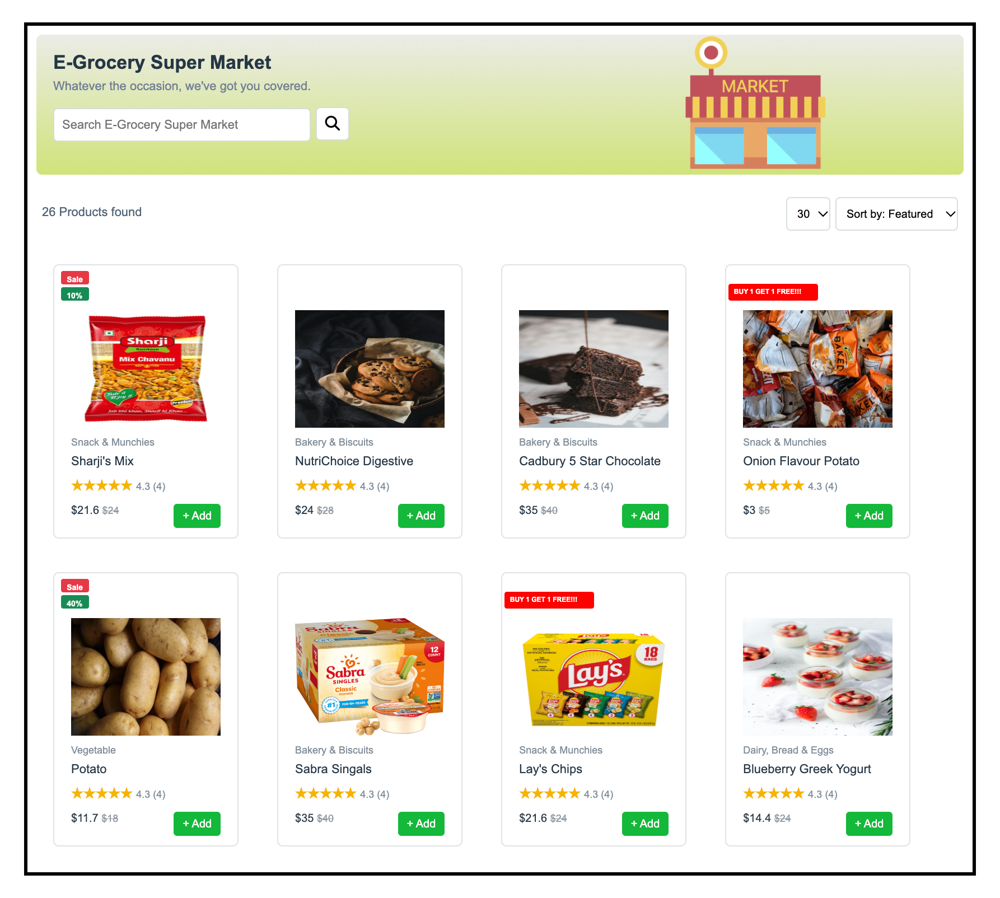

# 🛒 E-Grocery Super Market

A simple grocery shopping webpage built with **HTML5** and **CSS3**. The page displays grocery products in cards with product images, categories, ratings, prices, discounts, and add buttons.

## ✨ Features

- Gradient header with a grocery-store title
- Search input with a Font Awesome search icon
- Product count and sorting dropdowns
- Product cards with images and category labels
- Product ratings and current/old prices
- Sale and discount labels
- “Buy 1 Get 1 Free” promotional labels
- Add buttons on product cards

## 🧰 Technologies Used

- HTML5
- CSS3
- Font Awesome 6.5.2
- External product images

## 📁 Project Structure

```text
E-Grocery-Super-Market/
├── index.html
├── style.css
└── README.md
```

## 🚀 Run the Project

1. Download or clone this repository.
2. Open the project folder in Visual Studio Code.
3. Open `index.html` in your browser, or right-click it and choose **Open with Live Server**.
4. Keep `style.css` in the same folder as `index.html`.

## 🖥️ Output Preview

The webpage shows an **E-Grocery Super Market** header at the top, with a search field and grocery-store image. Under the header, it displays the product count and dropdown filters. Below that, grocery product cards appear in rows, showing product photos, category, name, star rating, price, discount information where applicable, and a green **+ Add** button.

> **Screenshot:** Add a screenshot of your running webpage to this repository and update the image path below.


## 📝 Notes

- The current search field, sorting dropdowns, and **+ Add** buttons are visual UI elements; JavaScript is needed to make them perform real actions.
- Product images are loaded from external URLs, so an internet connection may be needed to display them.
- Make sure the CSS file is named exactly `style.css`, matching the link in `index.html`.

## 👨‍💻 Author

Tarun

---

Created for HTML and CSS practice.
